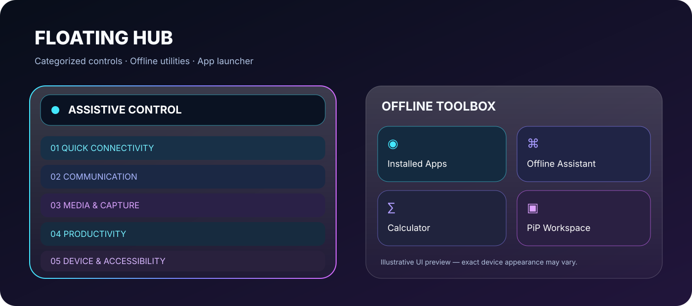

# Dynamic Island Ultra

<div align="center">


**Dynamic Island · Floating Assistive Hub · Built-in Offline Assistant · DuckDuckGo Browser · GitHub Updater**

[](https://github.com/adebojel/dynamic-island-ultra/actions/workflows/android.yml)
[](https://github.com/adebojel/dynamic-island-ultra/releases)
[-43E8FF?logo=android&logoColor=white)](https://developer.android.com/)
[](docs/NETWORK_AND_UPDATES.md)

[**Download latest signed APK**](https://github.com/adebojel/dynamic-island-ultra/releases/latest/download/app-release.apk) · [SHA-256](https://github.com/adebojel/dynamic-island-ultra/releases/latest/download/app-release.apk.sha256) · [All releases](https://github.com/adebojel/dynamic-island-ultra/releases)

</div>

---

## Overview

Dynamic Island Ultra is an Android floating island and assistive launcher with local utility tools, an in-app browser with DuckDuckGo as the default search engine and desktop/mobile modes, and a GitHub release updater. Its interface uses a dark glass/RGB design.



## Android compatibility

- **Minimum supported Android: Android 8.0 Oreo / API 26.**
- Compile SDK / target SDK: API 36.
- Android 8, 9, 10 and newer releases remain within the declared minimum compatibility range, subject to device/OEM behaviour.
- The CI gate checks `minSdk = 26`; it must not be raised to API 34.

## Current implementation

| Module | Included behaviour |
|---|---|
| Dynamic Island | Draggable floating pill, soft pulse and saved position |
| Battery | Live percentage/charging indicator while overlay is active |
| Notification bridge | Notification previews after the user grants notification-listener access |
| Assistive hub | Categorized Android settings and app shortcuts |
| App collection | Lists launcher-visible apps and launches selected apps |
| Local notes | Saves notes in app-private storage |
| Local calculator | Parses arithmetic expressions locally |
| Built-in offline assistant | Local command decision engine, calculator routing and feature/device diagnostics; no imported model, API key or cloud AI |
| App health checks | Reads overlay, notification, WebView, battery, storage and version readiness locally |
| PiP workspace | Android-managed PiP for this app's own workspace activity |
| DuckDuckGo browser | General HTTPS browser with DuckDuckGo default search, desktop/mobile mode, history navigation and reload |
| GitHub update center | Checks the latest project release, downloads the APK and SHA-256 file, verifies the hash, then opens Android's installer |

## Internet access, AdMob and Premium

The APK requests both `INTERNET` and `ACCESS_NETWORK_STATE`, so future online features can use the network without changing the platform compatibility floor. Android treats these as normal install-time permissions, not runtime popups.

- **DuckDuckGo Browser:** DuckDuckGo is the default home page and search engine. The address bar also opens other HTTPS websites. The mode control switches between mobile and desktop website layouts using the WebView User-Agent and viewport settings.
- **GitHub Update Center:** checks the latest project release, downloads the signed APK and metadata, verifies SHA-256, then opens Android's package installer.
- AdMob and Google Play Billing use network access only for their respective monetization flows. The built-in AI assistant, local diagnostics, notes and calculator remain offline by architecture and CI checks.

Cleartext HTTP is disabled; HTTPS is preferred. Network permission being available to the app does not mean each feature should upload user data. Modules must disclose their purpose and minimize transmitted data.

**AdMob is integrated using Google Mobile Ads Next-Gen SDK 1.7.0 and UMP SDK 4.0.0.** The manifest contains the publisher App ID and all four publisher ad units are configured. Debug APKs use Google's official test ad units; release APKs use production ad units. This separation is required: Google says always use test ads during development and warns that using live ads in testing may result in account suspension.

UMP consent information is refreshed at app launch, applicable consent forms are shown before ad requests, and every request is gated by `canRequestAds()`. A privacy-options entry point is shown whenever UMP requires it. The publisher must still publish consent messages under AdMob → Privacy & messaging and complete AdMob app review/eligibility before expecting production ad fill.

**Ad placement and frequency:** Banner and Native Advanced appear only on the dedicated Bonus & Premium screen. Native cards are clearly labelled “IKLAN”. Rewarded Ads and Rewarded Interstitial are requested only after a direct user action; Rewarded Interstitial has a disclosure dialog with “Lanjutkan” and “Lewati”. The application applies a combined cap of two video reward impressions per rolling 24 hours and a one-per-24-hour cap for Rewarded Interstitial. No ads are requested from the floating island, assistant, microphone, notifications, browser, permission centre or Android system controls. Delivered video duration is determined by the ad creative and cannot be guaranteed by the app.

### Premium and feature access

The core app remains free. Premium customization includes Advanced RGB Themes (Cyan, Violet, Emerald, Amber), Island Pulse FX (Soft, Normal, Fast, Off), Island Size, and Compact Panel layout. A successfully earned Rewarded Ads or Rewarded Interstitial reward grants these cosmetic options for 24 hours. These local ad rewards are not account-backed or fraud-resistant.

Paid Premium uses Google Play Billing Library 9.1.0 and subscription product ID `diu_premium`. The app queries active offers and shows the localized price returned by Google Play; it does not hardcode a purchasable price or simulate a successful purchase. Before paid plans appear, the publisher must create the product and activate base plans in Play Console. The intended starting price target is Rp2,000; final localized pricing and terms are controlled by Play Console.

Standard prepaid subscription durations include one week, four weeks, one, two, three, four, six, or eight months, and one year. Exact two-week, three-week, and two-year single base plans are not standard Indonesian Play Console subscription durations. Those need a separate one-time pass/secure entitlement design; this build does not display them as purchasable. Configure the intended Play base plans as prepaid if the goal is to avoid automatic renewal. Always display renewal, expiry, and cancellation terms returned by Google Play.

The current paid entitlement is checked with the Play Billing client on device and acknowledged according to Play Billing requirements. Before scaling valuable rewards or allowing accounts to synchronize Premium across devices, add a trusted backend that verifies purchase tokens with the Google Play Developer API.

See [Network and Update Design](docs/NETWORK_AND_UPDATES.md).

## Built-in AI and offline operation

The APK includes a deterministic local decision engine. It interprets supported commands, launches approved app/system surfaces, evaluates arithmetic and runs read-only diagnostics. It needs no model import, account, API key or internet.

**Technical distinction:** this engine is not a general-purpose generative LLM. A generative on-device model needs model weights plus an inference runtime. Official LiteRT-LM Android guidance describes model files from hundreds of MB to multiple GB and stores the model as a device file rather than APK assets. That would exceed or consume most of the current 400 MiB APK budget and would not run reliably on every Android 8+ device. We do not falsely label the built-in decision engine as a generative model.

## GitHub updates without uninstalling

The app's GitHub Update Center checks the latest release, compares its version code, downloads the APK and checksum, and verifies SHA-256 before passing it to Android's package installer.

Every successful signed build from `main` increments the patch tag from the latest published `v0.0.N`, so the next release after `v0.0.0` is `v0.0.1`, then `v0.0.2`, and so on. The internal Android `versionCode` uses the monotonically increasing GitHub Actions run number, so cancelled or failed CI runs cannot cause Android downgrade checks.

For Android to accept an update without uninstalling, all of these must remain true:
- Same application ID: `com.adebojel.dynamicislandultra`.
- Same release signing certificate (or a valid key-rotation lineage).
- New version code greater than or equal to the installed version.
- The user accepts Android's package-installer confirmation when shown.

### One-time GitHub signing setup

The stable private signing key must never be committed to this public repository. Add these repository **Actions secrets**:

- `RELEASE_KEYSTORE_BASE64` — base64 content of the private JKS/PKCS12 keystore.
- `RELEASE_STORE_PASSWORD` — keystore password.
- `RELEASE_KEY_ALIAS` — key alias.
- `RELEASE_KEY_PASSWORD` — key password.

Without all four secrets, CI builds a debug preview artifact only and deliberately does not publish it as an update-compatible release. Keep a secure offline backup of the keystore: if the private key is lost, Android will reject future updates signed with a different key.

The pre-existing `v0.0.0` asset was built before stable signing was configured. Moving from that legacy debug signature to a new stable key may require a one-time reinstall. After the stable key is configured and the user installs its first signed release, future releases can update in place and retain app data.

## PiP and Android boundaries

- PiP applies only to activities that declare and implement PiP support. This app cannot force other apps into PiP.
- The installed-app collection uses a narrow launcher query; apps without launcher activities may not be listed.
- A regular app cannot silently grant privileged access, force-stop immunity, arbitrary mobile-data/Wi-Fi toggles, or unrestricted control over other apps.
- Background restore remains subject to Android and device-maker restrictions.

## Permissions and privacy

The app requests overlay access, notification access/permission and install-from-this-source authorization only when their features need them. It does not request SMS, contacts, call logs, microphone capture, broad storage or broad package visibility. INTERNET and ACCESS_NETWORK_STATE are normal install-time network permissions.

DuckDuckGo searches and visited sites are handled by WebView and the selected website providers. GitHub update requests reveal ordinary connection metadata to GitHub. The offline assistant does not transmit commands or diagnostics.

## Build and release

Toolchain:
- JDK 17
- Android Gradle Plugin 9.3.1
- Gradle 9.9.1
- Compile SDK 36
- Compose BOM 2026.06.00 (Compose 1.11.x line, compatible with compile SDK 36)

Local debug build:

```bash
gradle --no-daemon testDebugUnitTest assembleDebug
```

A push to `main` runs the tests and build. CI checks the AdMob/UMP/Billing dependency and manifest configuration. With stable signing secrets configured, CI builds the release APK, verifies its APK signature with `apksigner`, calculates SHA-256, and publishes `app-release.apk`, `app-release.apk.sha256`, and `release-info.json` under a new versioned release. Debug builds use Google's official test ad units only; release builds use the publisher's production ad units. Without stable signing secrets CI uploads a debug-preview artifact but does not overwrite the update channel.

APK size is capped at 400 MiB. SHA-256 is provided for every APK artifact.

## Source and roadmap

- [Feature catalog](docs/FEATURE_CATALOG.md)
- [Feature roadmap](docs/FEATURE_ROADMAP.md)
- [Open-source research and license review](docs/OPEN_SOURCE_RESEARCH.md)
- [Network and update design](docs/NETWORK_AND_UPDATES.md)

## Validation status

CI tests and APK assembly are necessary but do not replace physical-device testing. The next verification gate is smoke-testing overlay lifecycle, notification access, DuckDuckGo search/navigation and website playback, package-installer handoff, data retention across a signed update, Android 8/9/10 and current Android OEM variants.

---

<div align="center">

**Offline AI core · Full network capability · User-controlled Android integration**

[Repository](https://github.com/adebojel/dynamic-island-ultra) · [Issues](https://github.com/adebojel/dynamic-island-ultra/issues)

</div>
