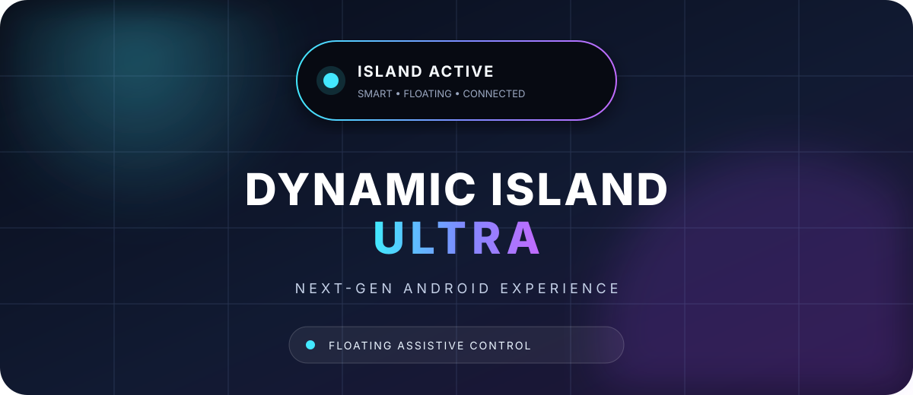

<div align="center">



# DYNAMIC ISLAND ULTRA

### Smart Interaction · Floating Assistive Bubble · Android

**A modular Android overlay experience with a dynamic pill, categorized floating shortcuts, and notification-preview foundations.**

[](https://github.com/adebojel/dynamic-island-ultra/actions/workflows/android.yml)
[](https://github.com/adebojel/dynamic-island-ultra/releases)
[](https://developer.android.com/)
[](https://kotlinlang.org/)

[**Download APK**](https://github.com/adebojel/dynamic-island-ultra/releases/download/v0.0.0/app-debug.apk)
· [Releases](https://github.com/adebojel/dynamic-island-ultra/releases)
· [Report an issue](https://github.com/adebojel/dynamic-island-ultra/issues)

</div>

---

## ✨ Product vision

Dynamic Island Ultra is an independent Android project inspired by common dynamic-island, floating-assistive-touch, and quick-tool experiences. It is being built as one modular app—not as a binary copy of third-party applications.

The long-term product plan includes a configurable dynamic island, notification and media activity cards, a categorized assistive bubble, system shortcuts, visual effects, gesture controls, accessibility-aware interactions, and optional AI capabilities.

## 📦 Download

<div align="center">

### Version 0.0.0 · Initial installable preview

[](https://github.com/adebojel/dynamic-island-ultra/releases/download/v0.0.0/app-debug.apk)

**[Open GitHub Release v0.0.0](https://github.com/adebojel/dynamic-island-ultra/releases/tag/v0.0.0)**

</div>

> The first APK is a debug-signed preview produced by GitHub Actions. It can be installed by sideloading after allowing installation from the source you use. It is not a Play Store-certified or production-key-signed build. Android may show an installation warning for apps installed outside Google Play.

## 🚀 Current build scope

| Capability | v0.0.0 status |
|---|---|
| Modern dark dashboard with cyan/violet styling | Included |
| Custom adaptive launcher icon | Included |
| Floating island overlay | Included |
| Draggable assistive bubble | Included |
| Categorized floating shortcuts | Foundation included |
| Android Wi-Fi / Bluetooth / Internet settings shortcuts | Included |
| Notification-listener integration | Foundation included; user must grant access |
| Notification preview broadcast to island | Foundation included |
| Boot receiver for user-enabled overlay | Foundation included; Android/OEM limits apply |
| Media session cards and playback controls | Planned |
| Incoming/ongoing call activity UI | Planned |
| Battery and charging activity cards | Planned |
| Custom theme editor and RGB effects | Planned |
| Gesture customization and haptics | Planned |
| AI assistant and offline speech models | Planned |
| Floating mini-app windows | Planned |
| Advanced utility toolbox | Planned |

This is an initial engineering baseline, not a claim that every item in the long-term roadmap is already implemented.

## 🧭 Floating bubble categories

The assistive panel groups shortcuts by purpose:

- **Quick tools:** Wi-Fi, Bluetooth, internet connectivity, sound settings.
- **Device & utilities:** display, battery, accessibility, and application settings.
- **Next modules:** media, calls, timer, calculator, notes, screen tools, and configurable user shortcuts.

Android intentionally routes several controls through system settings panels. An ordinary third-party app cannot silently toggle every protected system setting.

## 🔐 Permissions and privacy

Permissions are requested only when a feature needs them. The app does not silently grant itself privileged access.

| Permission / access | Why it is used |
|---|---|
| Display over other apps | Render the floating island and assistive bubble |
| Notification access | Read notification previews selected by the user |
| Post notifications | Show the foreground-service notification on Android 13+ |
| Ignore battery optimizations (optional) | Let the user review an Android exemption request |
| Boot completed | Restore a previously enabled experience after reboot, where Android allows it |
| Internet | Reserved for future opt-in online features; no account or analytics SDK is included in this baseline |

SMS, contacts, call-log, broad storage, microphone, camera, and accessibility-control permissions are **not** requested by this initial build. They must not be added without a concrete feature, a clear disclosure, and a valid Android/Google Play policy basis.

Notification content can contain sensitive information. Enable notification access only if you are comfortable allowing this app to read notification previews. The initial implementation processes previews locally and does not upload them.

## 📱 Compatibility

- Minimum Android version: Android 8.0 (API 26).
- Target SDK: Android 15 (API 35).
- Built with Kotlin, Jetpack Compose, AndroidX, and Gradle.
- Overlay appearance and background behavior can vary by device manufacturer and Android version.

## 🛠️ Build from source

Requirements:
- JDK 17
- Android SDK Platform 35
- Gradle 8.9 (the GitHub Actions workflow installs it)

Build a debug APK:

```bash
gradle --no-daemon assembleDebug
```

APK output:

```
app/build/outputs/apk/debug/app-debug.apk
```

## 🤖 GitHub Actions

Every push to `main` runs the Android build workflow. The workflow:
1. Checks out the main branch.
2. Installs JDK 17, Android SDK, and Gradle.
3. Builds the debug APK.
4. Uploads the APK as a workflow artifact.
5. Publishes or updates the `v0.0.0` GitHub Release asset.

The release workflow uses the repository's `GITHUB_TOKEN`; no personal access token is stored in source code.

## 🧱 Architecture

```text
app/
 └── src/main/
     ├── java/com/adebojel/dynamicislandultra/
     │   ├── MainActivity.kt
     │   ├── overlay/
     │   │   └── FloatingIslandService.kt
     │   ├── notifications/
     │   │   └── IslandNotificationListener.kt
     │   └── boot/
     │       └── BootReceiver.kt
     └── res/
         ├── drawable/
         ├── mipmap-anydpi-v26/
         └── values/
```

The code is intentionally separated by responsibility so that media, calls, battery events, gesture handling, themes, and AI can be added as independent components.

## ⚖️ Open-source intake policy

External code, assets, models, and libraries are not copied blindly. Each candidate must be checked for:
- License compatibility and attribution requirements.
- Security, maintenance activity, and dependency health.
- Android API and target-SDK compatibility.
- Runtime footprint, battery impact, and accessibility.
- Duplicate functionality and integration test coverage.

Third-party trademarks, proprietary artwork, and source code are not bundled unless their license explicitly permits the intended use.

## 🛡️ Android background and Play policy notes

No Android application can be guaranteed to be immune to force-stop, OEM task killers, battery controls, crashes, or operating-system restrictions. Users remain in control of special access. Reboot restoration is best-effort and subject to Android background-start restrictions and manufacturer behavior.

Google Play approval cannot be guaranteed by code. Any Play Store release must pass current policy review, prominently disclose sensitive access, request only necessary permissions, and use a properly protected production signing key.

## 🗺️ Roadmap

1. Stabilize overlay lifecycle, permission onboarding, and reboot behavior.
2. Add media-session activity cards and playback actions.
3. Add call-state and battery/charging cards.
4. Expand the assistive bubble with categorized, configurable utilities.
5. Add gesture, haptics, themes, and visual effects.
6. Add optional AI/voice features with explicit privacy controls.
7. Add automated tests, device matrix testing, and production signing.

---

<div align="center">

**Built for Android · Designed to be modular · Privacy-conscious by default**

[Repository](https://github.com/adebojel/dynamic-island-ultra) · [Issues](https://github.com/adebojel/dynamic-island-ultra/issues)

</div>
