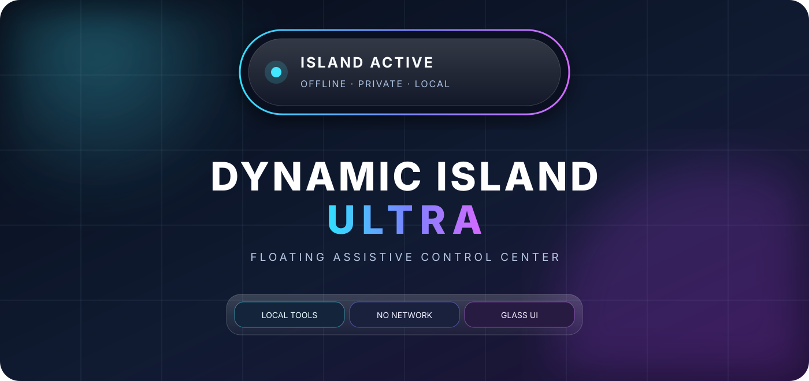

# Dynamic Island Ultra

<div align="center">



**Offline-first floating island · Assistive launcher · Local toolbox**

[](https://github.com/adebojel/dynamic-island-ultra/actions/workflows/android.yml)
[](https://github.com/adebojel/dynamic-island-ultra/releases)
[](https://developer.android.com/)
[](#offline-only-privacy)

[**Download APK v0.0.0**](https://github.com/adebojel/dynamic-island-ultra/releases/download/v0.0.0/app-debug.apk) · [SHA-256](https://github.com/adebojel/dynamic-island-ultra/releases/download/v0.0.0/app-debug.apk.sha256) · [Releases](https://github.com/adebojel/dynamic-island-ultra/releases)

</div>

---

## Product overview

Dynamic Island Ultra is an independent Android app combining a draggable floating island, assistive launcher, offline utility tools and an app-owned Picture-in-Picture workspace. It is inspired by common floating launcher and Dynamic Island patterns; it does not bundle proprietary source code, artwork or branding from third-party apps.


## Download and install

**Version:** 0.0.0 engineering preview

[Download installable APK](https://github.com/adebojel/dynamic-island-ultra/releases/download/v0.0.0/app-debug.apk)

[Open GitHub Release v0.0.0](https://github.com/adebojel/dynamic-island-ultra/releases/tag/v0.0.0)

[Download SHA-256 checksum](https://github.com/adebojel/dynamic-island-ultra/releases/download/v0.0.0/app-debug.apk.sha256)

> Debug-signed APK for sideload testing. It is not signed with a protected production key and is not a Google Play-certified release.

## Current implementation

| Module | Included behaviour |
|---|---|
| Dynamic Island | Draggable floating pill, soft pulse and saved position |
| Battery | Live percentage/charging indicator while overlay runs |
| Notification bridge | Local notification preview after notification-listener access is granted |
| Assistive hub | Five scrollable categories of Android settings/app shortcuts |
| App collection | Queries launcher-visible apps and opens selected apps |
| Offline notes | Saves text locally using app-private preferences |
| Offline calculator | Parses arithmetic expressions locally |
| Offline utility assistant | Rule-based local commands, battery status and arithmetic; not a chat service |
| PiP workspace | Android-managed PiP for this app's own workspace activity |
| Boot handling | Best-effort restore subject to Android/OEM restrictions |

## Floating bubble categories

1. **Quick connectivity:** Wi-Fi panel, internet settings panel, Bluetooth settings, sound settings.
2. **Communication:** dialer, app notification settings, notification-listener settings.
3. **Media and capture:** default music app, camera app, browser app.
4. **Productivity:** calculator, calendar, clock/alarms, five-minute timer, Android file picker.
5. **Device and accessibility:** display, battery, accessibility, application, app-info and system settings.
6. **My floating apps:** installed app collection, PiP workspace, offline notes, offline calculator.
7. **Offline intelligence:** local utility assistant.

Shortcut entries open Android settings or installed apps. They are not independent floating app windows.

## Offline-only privacy

- No `android.permission.INTERNET` or `ACCESS_NETWORK_STATE` permission.
- No online model endpoint, API key, analytics, ads, telemetry, remote configuration or cloud sync.
- Notes and assistant processing remain on-device.
- CI rejects common network permissions and network SDK dependencies.
- The assistant is a deterministic local command engine, not a generative LLM.

A future generative offline model must be imported as a local model file and reviewed for license, quantization, RAM, CPU/GPU support and storage use. Model files can exceed the 400 MiB budget on their own; they are not downloaded automatically or bundled by default.

## PiP and multi-window boundaries

Android PiP applies to activities designed and declared for PiP. This app provides PiP for its own workspace; it cannot force arbitrary third-party apps into PiP or bypass Android's window limits. See the [Android PiP guide](https://developer.android.com/develop/ui/views/picture-in-picture).

The installed-app collection uses a limited launcher query rather than `QUERY_ALL_PACKAGES`. Apps without a visible launcher activity may not appear.

## Permissions

The app uses overlay permission, notification posting/access (user-granted), foreground service and boot-completed permissions. It does not request SMS, call logs, contacts, microphone capture, broad storage or unrestricted package visibility.

Special permissions are granted by the Android Settings UI; an ordinary app cannot grant privileged access silently.

## Compatibility and pinned build toolchain

- Minimum Android: 8.0 / API 26.
- Compile/target SDK: API 36 (stable).
- JDK: 17.
- Android Gradle Plugin: 9.3.1.
- Kotlin: 2.4.21.
- Gradle: 9.7.
- Compose BOM: 2026.07.00 (stable release before API 37 requirement).
- Activity Compose: 1.13.0.

Build locally:

```bash
gradle --no-daemon testDebugUnitTest assembleDebug
```

APK output:

```text
app/build/outputs/apk/debug/app-debug.apk
```

## CI and APK size guard

Every push to `main` runs:
1. Offline manifest/dependency policy checks.
2. Unit tests for assistant command parsing and arithmetic.
3. Android debug APK compilation.
4. APK size enforcement against a 400 MiB ceiling.
5. SHA-256 generation.
6. Workflow artifact upload and update of GitHub Release `v0.0.0`.

## Known limitations

- The assistant is not a general-purpose generative language model.
- PiP works for PiP-enabled activities; third-party apps must independently support it.
- Arbitrary floating windows for other apps cannot be guaranteed by Android.
- Boot restore is best-effort. Force-stop, background-start restrictions and OEM battery managers may stop the app.
- Media-session cards, richer call cards, user-defined theme editor, gesture builder, screen recording, offline speech and local generative LLM remain planned.
- Debug APK is not production-signed or Play Store certified.
- Runtime behaviour still needs physical-device smoke tests across Android/OEM versions.

## Source structure

```text
app/src/main/java/com/adebojel/dynamicislandultra/
  MainActivity.kt
  ai/OfflineAssistant.kt
  ai/OfflineAssistantActivity.kt
  boot/BootReceiver.kt
  floating/FloatingAppRepository.kt
  floating/InstalledAppsActivity.kt
  floating/LocalToolActivities.kt
  notifications/IslandNotificationListener.kt
  overlay/FloatingIslandService.kt
  system/UtilityIntents.kt
```

## Open-source research and licensing

See [OPEN_SOURCE_RESEARCH.md](docs/OPEN_SOURCE_RESEARCH.md), [FEATURE_CATALOG.md](docs/FEATURE_CATALOG.md), and [FEATURE_ROADMAP.md](docs/FEATURE_ROADMAP.md). Third-party source is not incorporated until exact license, NOTICE, security, dependency and runtime footprint are reviewed.

## Android background and distribution

No application can be made immune to Android force-stop, crashes, system restrictions or OEM battery managers. Google Play approval cannot be guaranteed; a production release needs compliant disclosures, appropriate special-use service declarations and a protected signing key.

---

<div align="center">

**Offline-first · User-controlled · Modular Android utility**

[Repository](https://github.com/adebojel/dynamic-island-ultra) · [Issues](https://github.com/adebojel/dynamic-island-ultra/issues)

</div>
